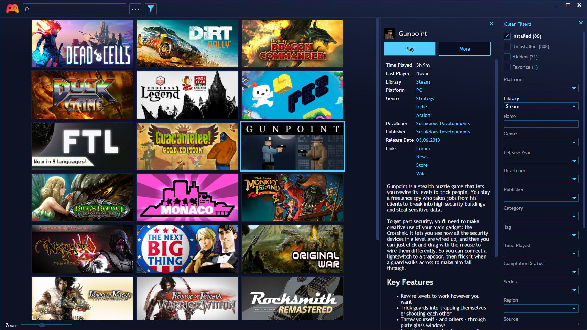
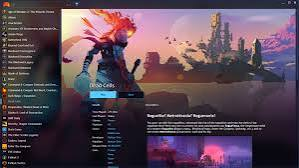

# Playnite for Unified PC Libraries and Emulated Games

Playnite Portable brings a game collection and its launcher interface into a movable application folder.
Playnite Game Launcher combines storefront libraries, manually added titles, and emulated games in one Windows interface.
Desktop and Fullscreen modes serve different ways of browsing the same collection.

[](https://playnite-portable.github.io/Playnite-Game-Launcher/)

## Game library

The playnite game library manager separates a game's library record from the software needed to run it.
A title can appear in the collection before it is installed.
Store integrations determine how games are imported and which client handles their installation or launch.

For a playnite pc collection, review the title, source, installed state, and play action before adjusting artwork.
A recognizable cover cannot correct an executable path or an emulator profile.

| Entry in the collection | Library information | Software still needed |
| --- | --- | --- |
| Storefront game | Title, source, metadata, installed state | The relevant client when required by the game |
| Manually added PC game | User-defined record and play action | The configured executable and its dependencies |
| Emulated game | ROM association and emulator profile | A working emulator and required supporting files |
| Uninstalled game | Imported ownership or library entry | Installation through the supported service workflow |

Import and manual-entry scenarios are represented by [InstalledGamesImport.Tests.ps1](tests/UI/InstalledGamesImport.Tests.ps1) and [CustomGames.Tests.ps1](tests/UI/CustomGames.Tests.ps1).
Their UI automation references include [InstalledGamesWindow.ps1](tests/Mapping/InstalledGamesWindow.ps1).
These supplied tests and extension samples are historical development materials, so their selectors and APIs may differ from current releases.

After importing, organize games with categories and review any missing metadata.
[GameEditWindow.Tests.ps1](tests/UI/GameEditWindow.Tests.ps1) contains examples of fields exercised during editing.
The corresponding automation models are [GameEditWindow.ps1](tests/Mapping/GameEditWindow.ps1) and [CategoryConfigWindow.ps1](tests/Mapping/CategoryConfigWindow.ps1).

Metadata search controls are represented in [MetadataLookupWindow.ps1](tests/Mapping/MetadataLookupWindow.ps1).
Choose the correct game result before accepting covers and descriptions, especially for similarly named releases.
Keep manually corrected fields in mind when downloading metadata again.



For emulation, configure a working profile before importing a large ROM collection.
The developer utility [generateRetroArchProfile.ps1](build/generateRetroArchProfile.ps1) relates to RetroArch profile generation.
It is a source-maintenance tool rather than the normal user interface for adding an emulator.

## Command line options

A controller session can start directly in Fullscreen mode.
The native executable accepts `--startfullscreen`, including switching an existing Desktop instance into Fullscreen mode.

The following PowerShell example assumes a portable copy at an example location.
Replace that location with the folder containing your installed executable.

```powershell
$playniteExecutable = 'D:\Games\Playnite\Playnite.DesktopApp.exe'
& $playniteExecutable --startfullscreen
```

Use `--startdesktop` when a shortcut should return to the editing-oriented Desktop interface.
These switches choose the interface; they do not change a game's graphics settings.

The `--start` argument launches a title by its Playnite library ID.
That ID belongs to the local library and should not be confused with a Steam application ID.
For an entry with several play actions, `--actionindex` selects an action using a zero-based index.

## Add-ons

The playnite open source launcher supports library extensions, metadata providers, scripts, and themes.
Select an extension according to the service or workflow it actually supports.
A theme changes presentation; it does not add a missing store integration.

The supplied [FullPowerShellScript.ps1](tests/Extensions/Scripts/FullPowerShellScript.ps1) illustrates older event callbacks.
[FullPythonScript.py](tests/Extensions/Scripts/FullPythonScript.py) is another historical scripting test, not evidence of current Python extension support.
The C# test implementations are [TestPluginDev.cs](tests/Extensions/Plugins/FullTestPluginDev/TestPluginDev.cs) and [TestPluginNuget.cs](tests/Extensions/Plugins/FullTestPluginNuget/TestPluginNuget.cs).

[LibraryExporter.psm1](tests/Extensions/Plugins/LibraryExporter/LibraryExporter.psm1) demonstrates a library-export workflow using an older database API.
For a current SDK example, the following script uses the documented Games collection instead.

Run it inside Playnite's Interactive SDK PowerShell window.
It saves a CSV shortlist of installed games with zero recorded playtime.

```powershell
$savePath = $PlayniteApi.Dialogs.SaveFile('CSV|*.csv')
if ($savePath) {
    $PlayniteApi.Database.Games |
        Where-Object { $_.IsInstalled -and $_.Playtime -eq 0 } |
        Sort-Object Name |
        Select-Object Name, Id |
        Export-Csv -LiteralPath $savePath -NoTypeInformation -Encoding UTF8
}
```

The save dialog chooses the output location, and canceling it skips the export.
Library records remain unchanged.
Zero recorded playtime means only that Playnite currently has no time recorded for that entry.
The CSV contains names and local IDs, so it is a shortlist rather than a complete library backup.

## Screenshots

Choose a theme after checking the information needed during everyday browsing.
A cover-heavy layout and a detailed list can serve different parts of a collection.

- In Desktop mode, check title readability, metadata fields, and filtering.
- In Fullscreen mode, check controller navigation and the selected game's visibility.
- Compare covers with different aspect ratios before judging the spacing.
- Review entries with missing artwork as well as fully populated ones.



[TestCover.jpg](tests/TestFiles/TestCover.jpg) and [TestIcon.png](tests/TestFiles/TestIcon.png) are test assets.
They help explain artwork-related test cases and do not represent an included game collection.
The older main-window automation model in [MainWindow.ps1](tests/Mapping/MainWindow.ps1) identifies list, grid, search, and filtering controls.

## Privacy Statement

Playnite stores its library data locally.
Connecting a storefront can involve the service's sign-in page and locally retained session information.
The authentication details depend on the integration.

Portable storage does not make every game dependency portable.
Game files, store clients, emulator paths, and supporting components may still live elsewhere.
Moving the launcher folder alone does not guarantee that every configured play action will work on another PC.

Use Playnite's backup facilities when preserving settings, library data, media, themes, or extension data.
An exported CSV and a copy of a few covers are not substitutes for that backup.

## Translations

The interface uses community-maintained localization.
[crowdin.yml](crowdin.yml) describes the mapping between source strings and translated resources.

The maintenance script [updateLocalizations.ps1](build/updateLocalizations.ps1) works with Crowdin translation data.
[VerifyLanguageFiles.ps1](build/VerifyLanguageFiles.ps1) checks whether localization XAML can be loaded.
[applyEnglishProofing.ps1](build/applyEnglishProofing.ps1) applies English proofreading changes to matching resource entries.

These tools expect localization resources from the complete source tree.
Those resources are absent from this selection.
When reporting a translation issue, include the language, the displayed text, and the screen where it appears.

## Development

This selection contains build helpers, UI tests, extension samples, and artwork.
The main application source and its solution are absent, so this is not a complete buildable checkout.

[RunTests.ps1](tests/RunTests.ps1) coordinates a historical Pester-based UI test sequence.
[TestExtensions.ps1](tests/TestExtensions.ps1) provides shared test helpers and configuration handling.
[PlayniteCommon.ps1](tests/PlayniteCommon.ps1) contains application paths and process helpers used by that test suite.

Reading a test file does not establish that it passes against a current application release.
In particular, older executable names, window identifiers, and plugin contracts need version-specific review.
Keep source version, installed application version, and SDK documentation aligned when developing an extension.

## FAQ, Known Issues, user manual

**Does Playnite replace every store client?**

Usually it complements those clients.
A game can still require its original service for installation, updates, authentication, or online features.

**Can Desktop and Fullscreen mode show different collections?**

They use the same library, while filters, themes, and presentation settings can make the visible selection differ.
Review those settings before treating a missing tile as a lost library record.

**Does a portable copy include the games themselves?**

The portable package is the launcher and its associated application data.
Game installations and emulator dependencies require separate attention when moving between computers.

## Related Search Terms

Playnite Portable, Playnite Game Launcher, playnite game library manager, playnite open source launcher, playnite pc, gaming, launcher, game-launcher, csharp, wpf, steam, gog, epic-games-store, emulator, retrogaming
